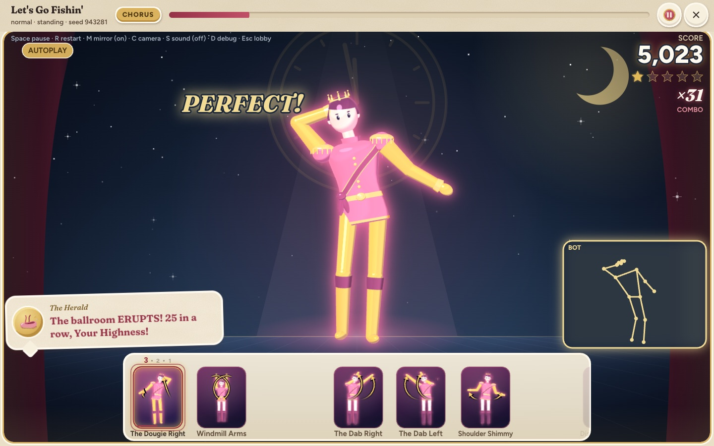
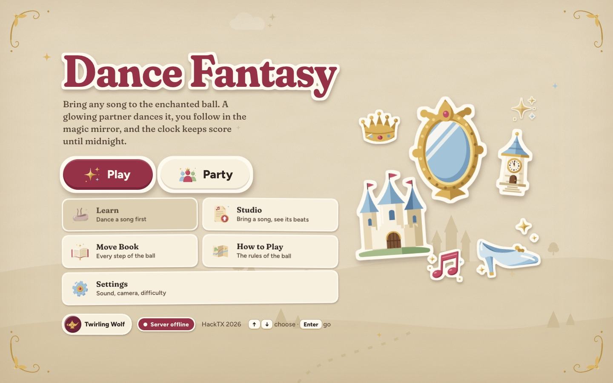
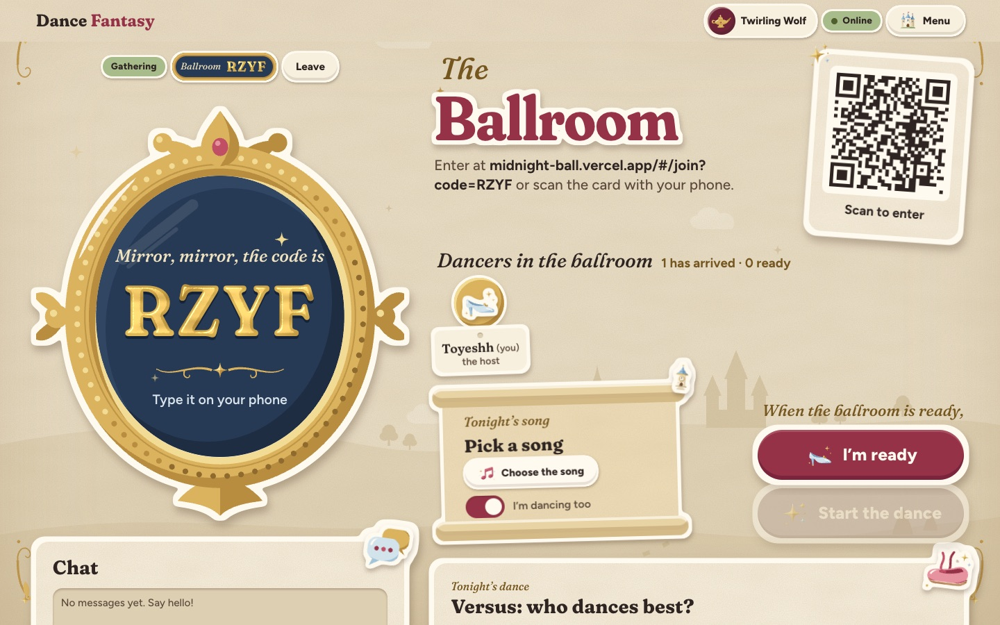
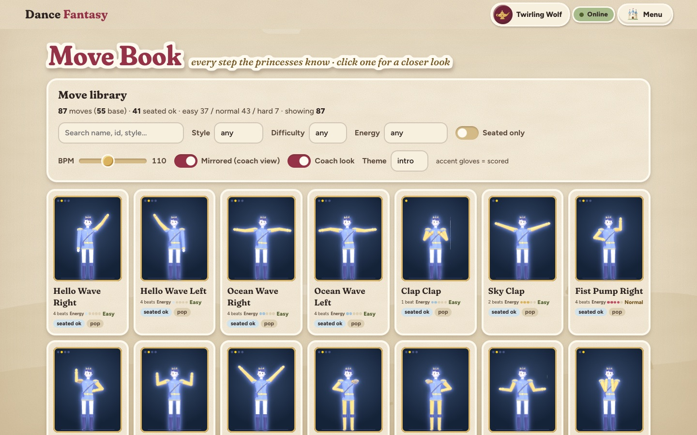

# Dance Fantasy

**Bring any song to the enchanted ball.** Dance Fantasy listens to a song you choose, choreographs
a dance routine for it that has never existed before, and teaches it to you with a 3D storybook
dancer while your webcam scores every beat. Dance alone, with friends in front of one laptop, or
in an online ballroom with friends on their own phones.

**[Play it live](https://midnight-ball.vercel.app)** · HackTX 2026 · *Once upon a time…*



## Inspiration

Dance games only let you dance to the songs someone already choreographed. We wanted the opposite:
*any* song, even one you recorded yesterday, becomes a playable dance. Then we wrapped it in the
fairy tale of the Twelve Dancing Princesses, who slip out every night to dance until their
slippers wear through, because a dance game should feel like a night at the ball.

## What it does

- **Any song becomes an original routine.** Upload a track; the server finds its beats, bars and
  sections (verse, chorus, bridge…) and choreographs moves that land on the downbeats, repeat on
  every chorus, and match the difficulty you pick.
- **A 3D princess or prince teaches it.** They dance the routine in a midnight ballroom, with the
  next moves sliding in as 3D cue cards.
- **Your webcam scores every beat:** Perfect / Good / OK / Miss, combos, stars, your best and
  hardest moves, and a highlight reel of your best streaks. Pose tracking runs entirely in your
  browser, so no video ever leaves your device.
- **The song's famous dance is built in.** If a song has a viral dance, the game finds it online
  and puts those moves into your routine, worth double points.
- **A Royal Herald** cheers you on by name, out loud, as your combo climbs.
- **Dance together, three ways:**
  - **Ballrooms**: friends join from their own phones by QR code, chat, and start on the same beat.
    Play **Versus** (who dances best) or **Crew** (bonus points when everyone hits a beat together).
  - **Party mode**: 2–4 friends in front of one laptop, each tracked and scored separately.
  - **Dance cards**: an automatic guest profile (sign in with a username and password to keep it),
    friend codes, invites, recent dance partners and history.
- **Learn mode** loops any 8 counts at half or three-quarter speed, with tips like "left arm late".

| Title menu | Online ballroom |
|---|---|
|  |  |

## What makes it different

- **Truly any song.** Other dance games ship hand-made routines for a fixed song list. We generate
  an original, playable routine from the audio itself in seconds: beat tracking, section analysis,
  then a search over 87 moves that keeps the dance musical (chorus moves repeat, big moves land on
  big beats).
- **3D from 2D.** Our routines are 2D poses, so the 3D dancer recovers depth from how short each
  limb looks on screen and the body's turn from the width of the shoulders. No 3D models, no motion
  capture: the dancer is built from simple shapes in three.js.
- **Multiplayer that runs on serverless.** Ballrooms work with no game server: devices sync to the
  server clock and start from one shared timestamp, so phones and laptops dance the same beat.
- **A storybook you can play.** Every screen is a hand-built fairy-tale sticker book: room codes in
  a magic mirror, a clock that strikes twelve when the song ends, and party awards like the Glass
  Slipper.

## How we used each sponsor's tools

### Meta Muse: the Royal Herald's voice of the ball
**Muse Spark** writes the herald's commentary live, from what *you* just did: your name, the song,
the move you nailed, your combo count, your grade. It reacts to your dancing as it happens, not to a
chat box. Muse goes first, Gemini is the fallback, and a hand-written line covers anything slower
than 2.5 seconds, so the show never waits.

### Google Gemini: three jobs
1. **The herald's voice.** Gemini text-to-speech performs every line with a directed delivery
   ("an ecstatic royal herald announcing the star of the ball"). Lines are voiced once and cached,
   and the music dips while the herald speaks.
2. **Turning a viral dance into choreography.** Gemini reads SerpApi's search results, names the
   song's signature dance, and maps it onto moves in our library so the dance becomes playable.
3. **Backup writer** for the herald when Muse is busy.

### SerpApi: search results that change the game
When you pick a song, SerpApi searches Google and YouTube for its dance challenge. The result
doesn't just show a link: Gemini identifies the moves, our choreographer **pins them onto the
chorus**, an in-game banner announces "Signature: YMCA arms", and those beats **score double**.
The source video is linked so you can watch the original.

### Tiger Data: the memory of the ball
Tiger Data (Postgres + TimescaleDB) holds everything multiplayer and social: ballrooms, dancers,
chat, accounts, friends and invites. Every round and every beat danced in a ballroom is stored in
**hypertables**, and a **continuous aggregate** rolls those beats up into each song's "hardest
moments", the beats that trip up dancers across every ballroom. It also keeps the paid AI and search
calls within daily and per-visitor limits.

### Also built with
**MediaPipe** (Google) for in-browser pose tracking · **librosa** for beat and structure analysis ·
**three.js** for the 3D dancers · **React + TypeScript + Vite** · **FastAPI (Python)** ·
**Vercel** (web, API and Blob storage).

## How it works

1. **Listen.** librosa finds the tempo, beats, downbeats and song sections, grouping repeats so
   every chorus is recognized as the same music.
2. **Choreograph.** A beam search picks moves from the library to fit each section, snapped to the
   downbeats, with signature moves pinned onto the chorus. The same song and settings always make the
   same routine, and "New routine" rolls a fresh one.
3. **Dance.** MediaPipe tracks 17 body joints from your webcam in the browser. A quick clap-along
   calibration measures your camera's delay, then each beat compares the direction of your arms,
   legs and torso with the dancer's.
4. **Together.** Ballroom devices sync to the server clock and post their beat scores about once a
   second, which powers the live leaderboard, Versus beats won and Crew sync streaks.



## Challenges we ran into

- **Depth from flat poses.** Moves are stored as 2D joint positions, so making a convincing 3D
  dancer meant reconstructing depth (knee lifts, spins) from limb foreshortening.
- **Webcam lag.** Cameras show you about 100–300 ms late, which made perfect dancers score "late". The magic-mirror calibration measures that delay with a clap-along and subtracts it.
- **Audio analysis on serverless.** librosa and its numerical stack are about 430 MB, well past
  normal serverless limits, so the API runs as a large function with a shared cache.
- **Real-time play without a game server.** We built rooms on short polling and a shared start
  time, so up to 8 phones and laptops dance the same beat on a serverless backend.

## Try it

**[midnight-ball.vercel.app](https://midnight-ball.vercel.app)** in Chrome with a webcam. Pick a
song, press **Start the ball**, stand back so your whole body is in the mirror, and dance. No webcam?
Turn on **Autoplay** in the lobby to watch the bot dance.

To run it locally (Node 22+ and [uv](https://docs.astral.sh/uv/)):

```bash
make setup   # Python, npm packages and the pose-tracking model
make dev     # opens the API on :8000 and the game on http://localhost:5173
```

API keys are optional (see [.env.example](.env.example)): without them the herald uses hand-written
lines and ballrooms use a local database. Technical docs: [shared/README.md](shared/README.md).

## Team

**Toyeshh Medikonda**, **Luv Udeshi** and **Suchay Kommisetty**, in one night at HackTX 2026.

## AI tools used

- **Claude Code** (Anthropic) helped us scaffold and write the code, including parallel agents that
  built and reviewed features on separate branches.
- **Meta Muse**, **Google Gemini** and **SerpApi** power features in the game, as described above.
- **MediaPipe** (Google) for pose tracking.

## Credits

Sample songs: "Vibe Ace" by Kevin MacLeod and "Let's Go Fishin'" by Karissa Hobbs (both CC BY 3.0,
from [Free Music Archive](https://freemusicarchive.org) via librosa's example data), plus synth
tracks we generated (CC0). Fonts: Fraunces and Figtree. Webcam frames and poses never leave your
browser.
